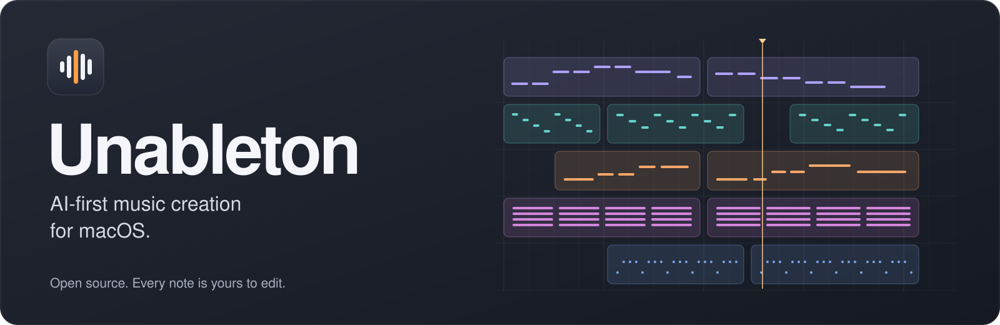
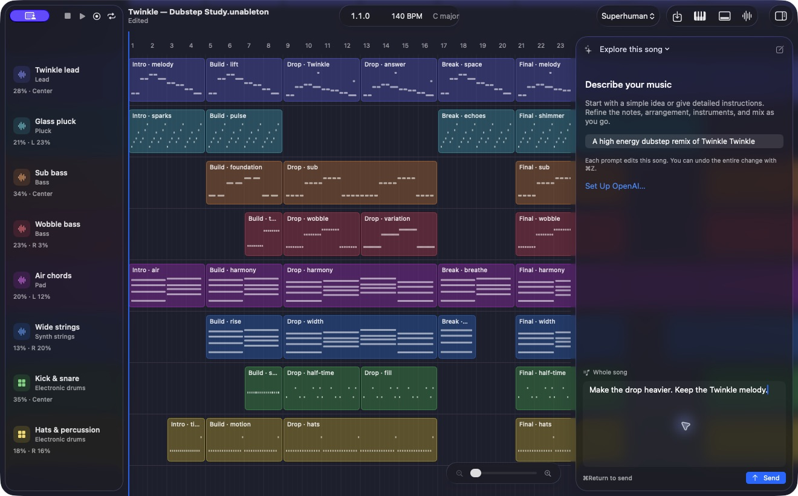
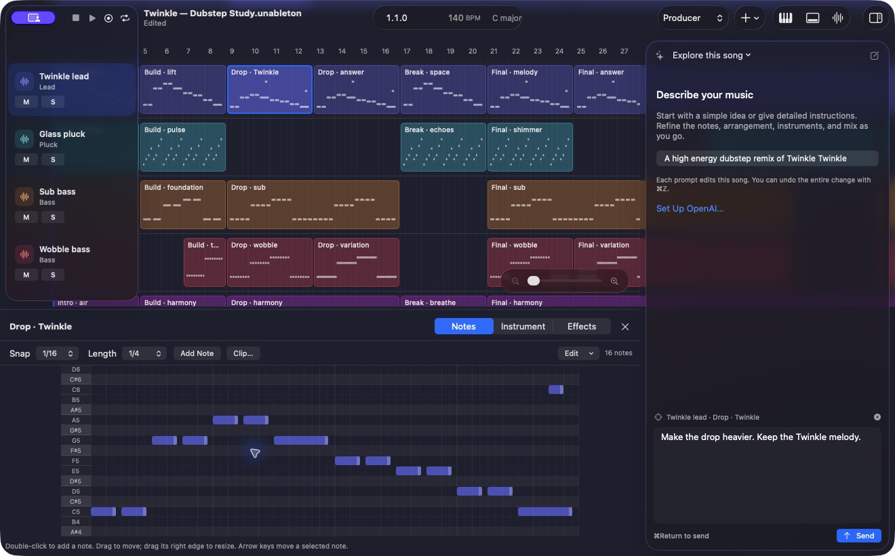
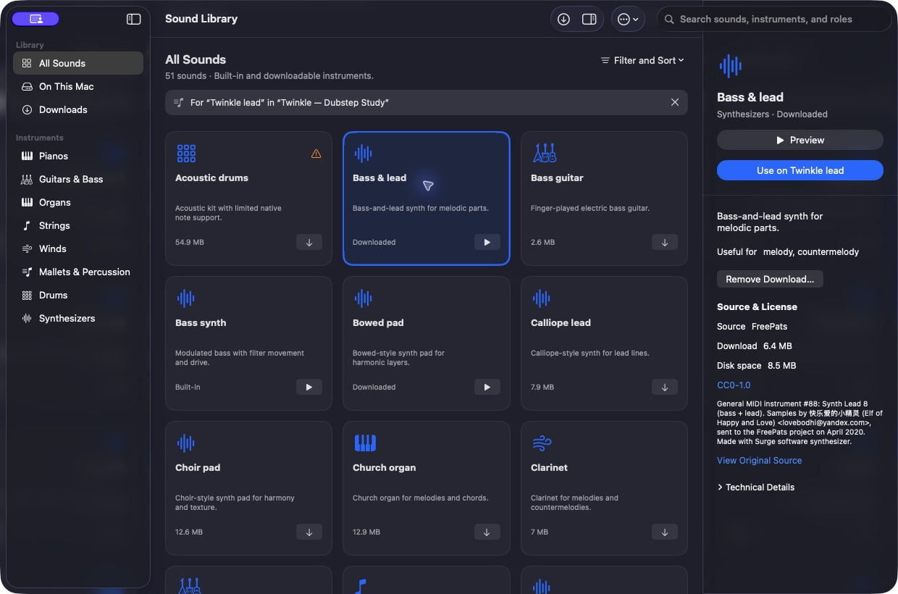
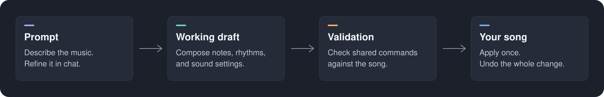

<p align="center">
  
</p>

<p align="center">
  <strong>Describe the music. Refine it in chat. Keep every note editable.</strong><br>
  A native, open-source music editor built with SwiftUI, AVAudioEngine, and C++.
</p>

<p align="center">
  <a href="#get-started">Get started</a> &nbsp; / &nbsp;
  <a href="#two-ways-to-work">Workspace modes</a> &nbsp; / &nbsp;
  <a href="#sound-library">Sound Library</a> &nbsp; / &nbsp;
  <a href="docs/user-guide.md">User guide</a> &nbsp; / &nbsp;
  <a href="#development">Contribute</a>
</p>

<p align="center">macOS 26+ &nbsp; · &nbsp; Swift 6.2+ &nbsp; · &nbsp; Apache 2.0 &nbsp; · &nbsp; Development preview</p>



Unableton turns musical ideas into tracks, notes, rhythms, instrument settings, and arrangements. Start with a prompt such as **“A high energy dubstep remix of Twinkle Twinkle,”** then ask for a heavier bass, a different chorus, or a quieter ending. Keep several conversations attached to the same song.

Instrument parts stay editable. Recordings and generated singing stay audio. Each completed AI edit applies as **one undoable change**.

<sub>These are real app captures using a locally prepared demonstration arrangement. They show the interface, not a recorded AI-generation run. The refinement prompt shown is unsent.</sub>

## What you can do

| | In Unableton |
| --- | --- |
| **Compose through chat** | Generate and refine separate musical parts, sound settings, and arrangements. Start a fresh chat on the same song whenever you need one. |
| **Edit the details** | Move, split, trim, and duplicate clips. Edit notes and velocities in the piano roll. Adjust synth parameters, mixing, and effects. |
| **Transcribe a performance** | Whistle, hum, sing a melody, or beatbox. Review detected notes, choose instruments and layers, then add them to the song. |
| **Record and sing** | Record or import audio. Generate singing from a melody and aligned lyrics through an optional vocal provider. |
| **Choose your sounds** | Start with six built-in synth/electronic sounds. Browse, preview, and download sampled instruments from FreePats. |
| **Keep your work** | Save the song, audio, chats, and generation history in a native `.unableton` package. Export stereo WAV or multitrack MIDI. |

## Get started

Download the **Apple Silicon development preview** from [GitHub Releases](https://github.com/VirajShah21/unableton/releases/latest). Open the DMG and drag Unableton to Applications. It requires **macOS 26 or newer** and is ad-hoc signed, not notarized, so macOS may block it from opening.

To build from source, you also need Xcode command-line tools with **Swift 6.2 or newer**.

```sh
git clone https://github.com/VirajShah21/unableton.git
cd unableton
./script/build_and_run.sh
```

The script builds, stages, ad-hoc signs, and opens `dist/Unableton.app`. It downloads no sampled sounds. Use this script to launch the GUI with its icon, document registration, and microphone privacy text.

1. Open **Unableton → Settings**. Save your OpenAI API key and use **Test Connection** to check the selected model.
2. Start a song and describe what you want in chat. **Automatic** begins with an economical model and can upgrade once; choose a fixed model to keep requests on that model.
3. Listen, select a track or clip for context, and ask for changes. Use **Command-Z** to undo an entire AI edit.
4. Open **Sound Library** from the toolbar when you want more instruments.

Manual editing, built-in playback, and faithful local transcription work offline. Cloud composition uses your own OpenAI key and provider billing. Optional vocals and Jev review use separate accounts and keys.

Credentials stay outside Git and song documents. They use an unencrypted, owner-only local file by default; **Settings → Credentials → Use macOS Keychain for Credentials** enables Keychain. [Setup, storage, and model options](docs/user-guide.md#ai-setup).

## Two ways to work

The same song has two views. Switch from the toolbar or the View menu without interrupting playback or AI work.

| Superhuman | Producer |
| --- | --- |
| The default. Compose through AI and inspect every part. | Show the full editing interface. |
| Navigate, select tracks and clips, inspect notes and sound settings. | Edit clips, notes, instruments, mix controls, and effects. |
| Keep recording, importing, Transcribe, export, and Undo. | Keep those same workflows with direct musical editing. |
| **Control-Command-1** | **Control-Command-2** |



The track list stays pinned on the left, the timeline ruler stays pinned above the clips, and chat floats on the right in native Liquid Glass. Both modes preserve selection, conversations, and the song.

## Sound Library

**Browse, preview, download, and choose sounds in one place.** Open it directly from the toolbar, **Window → Sound Library**, or **Choose Sound…** in the instrument editor.



- **Six built-in sounds:** Bass, Lead, Pad, Pluck, Synth strings, and Electronic drums. Ready offline.
- **45 downloadable sampled sounds across 42 FreePats banks:** pianos, guitars and basses, organs, strings, winds, mallets, percussion, and synthesizers.
- **Explicit local previews:** selection never starts audio. Preview pauses a playing song at its current position and is blocked during capture.
- **Download what you use:** no sampled banks ship in the app. Downloads are verified, shared across songs, and available offline after installation.
- **Choose with context:** Producer shows the named target track and applies a sound as one undoable edit. Superhuman keeps browsing, downloads, and previews available.

Missing sounds never prevent opening or saving a song. Playback and WAV export explain which downloads are required instead of substituting sounds. Each bank keeps its own license and attribution. [Catalog and compatibility notes](docs/sound-catalog.md).

## From a performance to notes

Open **Transcribe** from the toolbar or press **Shift-Command-T**.

1. **Record or import.** Choose Whistle, Humming, Singing, or Beatboxing. Listen to the song, follow a silent timeline, or perform solo. Choose **Stop & Transcribe** when finished.
2. **Review and preview.** Check detected events. Preserve Time keeps measured timing; optional Auto-time can fit the performance to the song. Choose one instrument or layer several, with optional AI accompaniment.
3. **Add to Song.** Insert at the recorded start or a chosen position as one undoable edit. Recording alone never inserts anything.

Preserve Time with a single performance layer runs locally without an API request. Singing mode detects a melody; it does not transcribe lyrics. Detection is monophonic and can make mistakes. [Full Transcribe workflow](docs/transcription.md).

For generated singing, enable an optional provider in **Settings → Vocals**. Audial requires a reference voice supplied with consent. Rinoa remains experimental because its published integration terms need clarification. Provider access, billing, and usage rights are separate from Unableton's code license. [Vocal generation](docs/vocal-generation.md).

## How AI edits a song



The AI works on a draft captured from the current song revision. Typed tools let it inspect the project, discover instruments, edit music, and render local previews. Manual controls and AI tools share the same validated command layer.

A completed draft commits once. Cancellation, invalid output, and provider failures leave the live arrangement intact. If the song changes during generation, the harness can replan once instead of overwriting concurrent edits. Multiple chats share a project queue.

Local musical analysis records factual changes after an edit. Optional **Jev review** observes bounded symbolic reports; it does not listen to audio, reject edits, or repair the song. [Draft analysis and review](docs/draft-review.md).

## Development

```sh
swift build
swift test
./script/build_and_run.sh --verify
```

The test suite uses isolated transports and deterministic audio fixtures; it needs no provider keys. The run script also supports `--build-only`, `--debug`, `--logs`, and `--telemetry`. Python 3 is needed only for optional catalog-audit scripts.

| Target | Responsibility |
| --- | --- |
| `Unableton` | SwiftUI document windows, workspace state, menus, and Settings |
| `UnabletonCore` | Song models, instrument metadata, validated commands, persistence, and MIDI |
| `UnabletonLibrary` | Verified downloads, imports, installation, and sound-resource leases |
| `UnabletonAudio` | Playback, recording, local transcription, and offline rendering |
| `UnabletonDSP` | C++ synthesis and scheduling, with Objective-C++ audio glue |
| `UnabletonAI` | Responses harness, transcription arrangement, vocals, and draft review |

Playback and export share a sample-timed musical schedule. Audio callbacks do no networking, disk I/O, or AI work. Song documents own the music and conversations; window state and credentials stay separate.

Read [AGENTS.md](AGENTS.md) for product direction and engineering rules. Changes to musical behavior belong in shared project commands before being exposed through the UI or AI. Keep API keys, song packages, sampled banks, and build output out of commits.

Bug reports and focused pull requests are welcome. Include reproduction steps and relevant checks. See the [user guide](docs/user-guide.md) for detailed behavior and [verification notes](docs/verification.md) for tested flows and remaining release checks.

## Build a DMG

Install [create-dmg](https://github.com/create-dmg/create-dmg), then run the packaging script from a graphical macOS session:

```sh
brew install create-dmg
./script/package_dmg.sh
```

The script builds a Release app at `dist/release/Unableton.app` and creates `dist/Unableton-<version>.dmg`. The DMG opens with the music-themed [background](Resources/DMG/background.png), the app, and an Applications shortcut. Drag Unableton to Applications to install it. Packaging uses Finder to save the window layout; macOS may ask for permission to automate Finder.

Use `--app /path/to/Unableton.app` to package an existing app without modifying it, `--output /path/to/Unableton.dmg` to choose the destination, and `--overwrite` to replace an existing DMG. Run `./script/package_dmg.sh --help` for details. Build output stays outside Git; packaging downloads no sound banks.

The default app is ad-hoc signed for development. Creating a DMG does not make it a signed public release: Developer ID signing, notarization, and stapling remain separate release work.

## Project status

Unableton is a **development preview**. Source is available under Apache 2.0; signed distribution, notarization, full VoiceOver acceptance, and macOS 27 validation remain release work.

One project plays or records at a time. Imported and generated audio retains its original speed and pitch after tempo or note edits. Polyphonic transcription, lyric transcription, third-party plugin hosting, external MIDI recording, advanced time stretching, and comping are outside this version.

## License

Application code is licensed under [Apache 2.0](LICENSE). Downloaded instruments retain their individual licenses; see [third-party notices](THIRD_PARTY_NOTICES.md). Provider models, voices, and generated outputs have their own terms. No sampled banks or demo audio are bundled in the repository or app.
